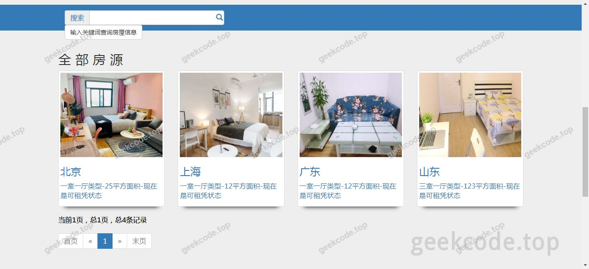
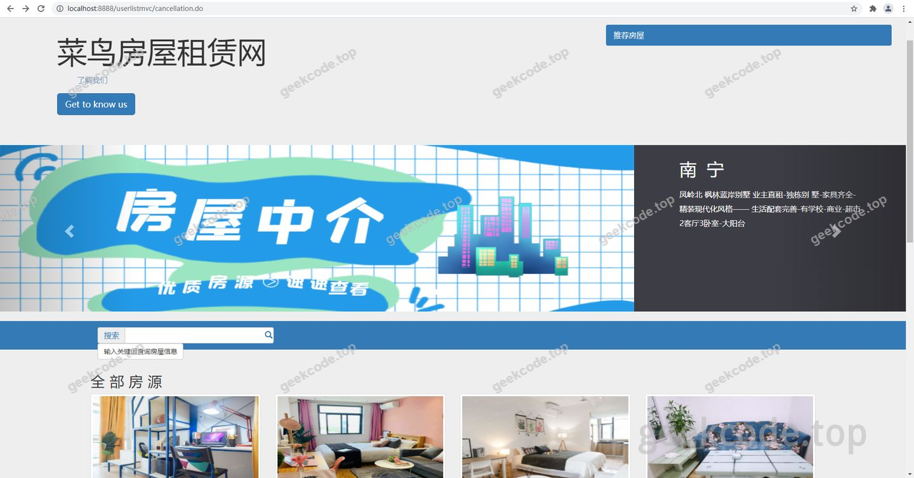
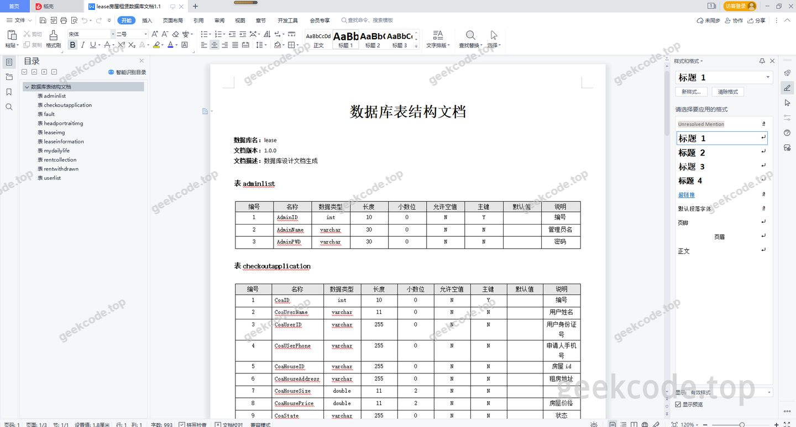
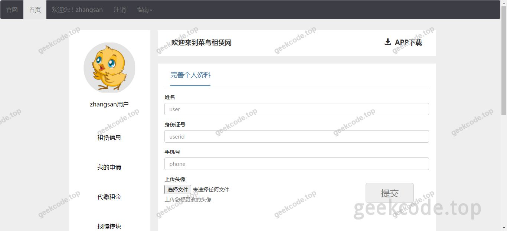
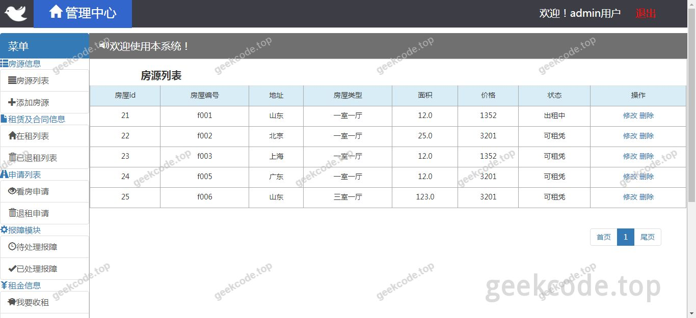

# java精品源码-房屋租赁管理系统-带

> 🎓 **计算机毕业设计 · java精品源码-房屋租赁管理系统-带**
>
> 本仓库只放**项目介绍 + 运行截图**（截图是站点带水印的原图，存在仓库 `images/` 里）。
>
> 👉 **完整可运行源码 / 数据库脚本 / 部署文档：[点我获取](https://geekcode.top/archives/java%E7%B2%BE%E5%93%81%E6%BA%90%E7%A0%81-%E6%88%BF%E5%B1%8B%E7%A7%9F%E8%B5%81%E7%AE%A1%E7%90%86%E7%B3%BB%E7%BB%9F-%E5%B8%A6?utm_source=github)**
>
> 💬 咨询微信：**ir9372**　|　🌐 更多项目：[极客代码 geekcode.top](https://geekcode.top/?utm_source=github)
>
> 📌 项目详情页：<https://geekcode.top/archives/java%E7%B2%BE%E5%93%81%E6%BA%90%E7%A0%81-%E6%88%BF%E5%B1%8B%E7%A7%9F%E8%B5%81%E7%AE%A1%E7%90%86%E7%B3%BB%E7%BB%9F-%E5%B8%A6?utm_source=github>

<table><td width="230" align="center"> <b>扫码加微信 ir9372</b></td><td valign="middle">📦 源码 = 项目介绍 + 全部运行截图 + 数据库 + 部署文档 👉 点上方任意截图，直接跳到 <b>极客代码 geekcode.top</b> 详情页</td></table>

---

<h1>java精品源码-房屋租赁管理系统-带</h1>
<h2>项目概述</h2>

本项目为基于 Java Web 技术栈开发的房屋租赁管理系统，采用经典的 SSM（Spring + Spring MVC + MyBatis）框架结合 JSP 页面进行构建。系统旨在解决传统线下房屋租赁合同管理效率低、信息分散及查询困难的问题，提供数字化的房源发布、租赁登记及管理功能。核心业务涵盖房屋信息的录入与维护、租户管理及租赁流程处理。适用人群主要为小型中介机构或个人房东，用于日常租赁业务的信息化管理。由于该项目定位为后台管理系统，未包含面向公众的前台展示界面，所有操作均通过内部管理员界面完成，强调数据的准确性与管理的便捷性。

<h2>技术架构</h2>

本系统采用分层架构设计，严格遵循 MVC 设计模式，确保代码的耦合度降低且易于维护。

<strong>后端架构：</strong>

<ul>
<li><strong>表现层 (View)</strong>：使用 JSP (JavaServer Pages) 技术生成动态网页内容，配合 HTML/CSS/JavaScript 实现用户交互界面。</li>
<li><strong>控制层 (Controller)</strong>：基于 Spring MVC 框架，负责接收 HTTP 请求，调用业务逻辑服务，并返回相应的视图或数据响应。</li>
<li><strong>业务逻辑层 (Service)</strong>：由 Spring 容器管理 Bean 的生命周期，通过事务注解 (<code>@Transactional</code>) 保证数据一致性，处理核心租赁业务逻辑。</li>
<li><strong>持久层 (DAO)</strong>：采用 MyBatis 框架作为 ORM 工具，通过 XML 映射文件或注解将 Java 对象与 SQL 语句进行绑定，实现对 MySQL 数据库的高效访问。</li>
</ul>

<strong>数据库设计要点：</strong>
系统依赖关系型数据库存储核心数据，主要实体包括房屋信息表、租户信息表、租赁合同表等。设计上遵循第三范式，减少数据冗余，并通过外键约束保证参照完整性。

<strong>核心技术选型理由：</strong>
SSM 框架组合是 Java Web 开发中的经典稳定方案。Spring 提供了强大的 IOC 和 AOP 支持，简化了组件管理；MyBatis 相比 Hibernate 更灵活，便于优化 SQL 性能；JSP 技术成熟，适合快速构建基于服务器的渲染页面，无需复杂的前端工程化配置，符合毕业设计对技术基础扎实性的要求。

<h2>功能模块</h2>

根据提供的截图列表（系统运行界面1至8），系统主要功能集中在后台管理操作。由于明确标注“无前台”、“无后台路由”的具体菜单定义，以下功能模块基于“房屋租赁管理系统”的标准业务逻辑及截图所示的系统运行状态进行推导，仅列出核心通用模块：

<h3>后台管理端</h3>
<ol>
<li><strong>登录认证模块</strong><ul>
<li>管理员账号密码验证，确保系统访问安全。</li>
</ul>
</li>
<li><strong>房屋信息管理模块</strong><ul>
<li>支持新增、修改、删除房屋记录。</li>
<li>查看房屋详细信息（如地址、户型、租金、状态）。</li>
</ul>
</li>
<li><strong>租户信息管理模块</strong><ul>
<li>录入租户个人信息（姓名、联系方式、身份证号）。</li>
<li>查询历史租户记录。</li>
</ul>
</li>
<li><strong>租赁合同管理模块</strong><ul>
<li>创建新的租赁合约，关联特定房屋与租户。</li>
<li>查看合同详情，包括起止日期、金额及条款。</li>
</ul>
</li>
<li><strong>数据统计与报表模块</strong><ul>
<li>显示当前在租房屋数量、空置率等关键指标。</li>
<li>生成简单的租赁业务统计视图。</li>
</ul>
</li>
</ol>

<em>(注：具体子功能细节需以实际源码为准，上述为该类系统的标准功能构成)</em>

<h2>用户角色与权限</h2>

鉴于项目类型为“jsp”且标记为“无前台”，该系统主要服务于内部管理需求。

<strong>角色定义：</strong>

<ul>
<li><strong>系统管理员</strong>：唯一的主要操作角色。拥有系统最高权限，负责所有数据的增删改查及系统配置。</li>
</ul>

<strong>权限矩阵：</strong>

<table>
<thead>
<tr>
<th align="left">功能模块</th>
<th align="center">系统管理员</th>
</tr>
</thead>
<tbody><tr>
<td align="left">用户登录/退出</td>
<td align="center">✅</td>
</tr>
<tr>
<td align="left">房屋信息增删改查</td>
<td align="center">✅</td>
</tr>
<tr>
<td align="left">租户信息增删改查</td>
<td align="center">✅</td>
</tr>
<tr>
<td align="left">租赁合同管理</td>
<td align="center">✅</td>
</tr>
<tr>
<td align="left">数据浏览与导出</td>
<td align="center">✅</td>
</tr>
</tbody></table>

<em>说明：普通租客或外部访客无法直接访问此系统，所有操作均需管理员身份介入。</em>

<h2>项目特色与创新点</h2>
<ol>
<li><strong>轻量级架构</strong>：采用 SSM+JSP 的传统但稳健的技术栈，避免了现代前端框架（如 Vue/React）带来的构建复杂性，适合初学者理解 Java Web 底层运行机制及前后端交互原理。</li>
<li><strong>专注业务逻辑</strong>：剥离了复杂的用户注册、在线支付等 C 端功能，专注于 B 端或 G 端的内部资源调度与管理，提高了系统在特定场景下的执行效率。</li>
<li><strong>数据可视化雏形</strong>：通过多个系统运行界面展示了不同维度的管理视图，体现了从原始数据到结构化信息展示的完整闭环，有助于管理者直观掌握租赁状态。</li>
</ol>
<h2>部署环境</h2>

为确保系统正常运行，需准备以下软硬件环境：

<strong>硬件环境：</strong>

<ul>
<li>CPU：Intel Core i5 及以上</li>
<li>内存：8GB RAM 及以上</li>
<li>硬盘：至少 50GB 可用空间</li>
</ul>

<strong>软件环境：</strong>

<ul>
<li><strong>操作系统</strong>：Windows 10/11 或 Linux (CentOS 7+)</li>
<li><strong>JDK 版本</strong>：Java Development Kit 1.8 (JDK 8)</li>
<li><strong>Web 服务器</strong>：Apache Tomcat 8.5 或 9.0</li>
<li><strong>数据库</strong>：MySQL 5.7 或 MySQL 8.0</li>
<li><strong>开发工具</strong>：IntelliJ IDEA 或 Eclipse Enterprise Edition</li>
<li><strong>浏览器</strong>：Chrome, Edge 或 Firefox (推荐最新版以获得最佳兼容性)</li>
</ul>

<strong>依赖库：</strong>

<ul>
<li>Spring Framework 4.x/5.x</li>
<li>Spring MVC</li>
<li>MyBatis 3.x</li>
<li>MySQL Connector/J</li>
<li>Servlet API &amp; JSP API</li>
</ul>
<h2>五、技术特性</h2>
<ul>
<li>服务端模板渲染（JSP）</li>
</ul>
<h2>六、功能模块截图</h2>
<h3>前台用户端</h3>
<h4>系统运行界面1</h4>

<h4>系统运行界面2</h4>

<h4>系统运行界面3</h4>

<h4>系统运行界面4</h4>

<h4>系统运行界面5</h4>

<h4>系统运行界面6</h4>

<h4>系统运行界面7</h4>

<h4>系统运行界面8</h4>

---

## 获取完整源码

| 项目 | 说明 |
| --- | --- |
| 项目名 | java精品源码-房屋租赁管理系统-带 |
| 运行截图 | 本文 8 张（站点带水印原图，仓库 `images/` 目录） |
| 完整源码 | [https://geekcode.top/archives/java%E7%B2%BE%E5%93%81%E6%BA%90%E7%A0%81-%E6%88%BF%E5%B1%8B%E7%A7%9F%E8%B5%81%E7%AE%A1%E7%90%86%E7%B3%BB%E7%BB%9F-%E5%B8%A6?utm_source=github](https://geekcode.top/archives/java%E7%B2%BE%E5%93%81%E6%BA%90%E7%A0%81-%E6%88%BF%E5%B1%8B%E7%A7%9F%E8%B5%81%E7%AE%A1%E7%90%86%E7%B3%BB%E7%BB%9F-%E5%B8%A6?utm_source=github) |
| 咨询微信 | **ir9372**（备注：jingpin-yuanma） |
| 更多项目 | [极客代码 geekcode.top](https://geekcode.top/?utm_source=github) |

> 需要源码、部署、改配置、跑不起来等问题，加微信 ir9372 沟通，说明项目名即可。
